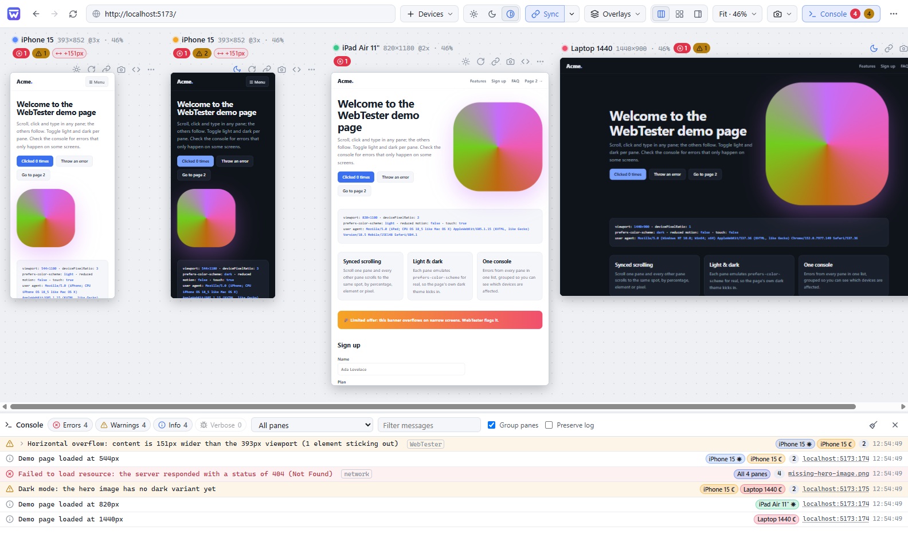
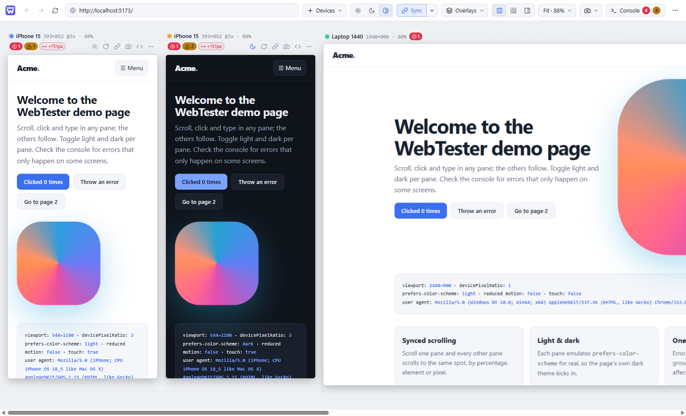
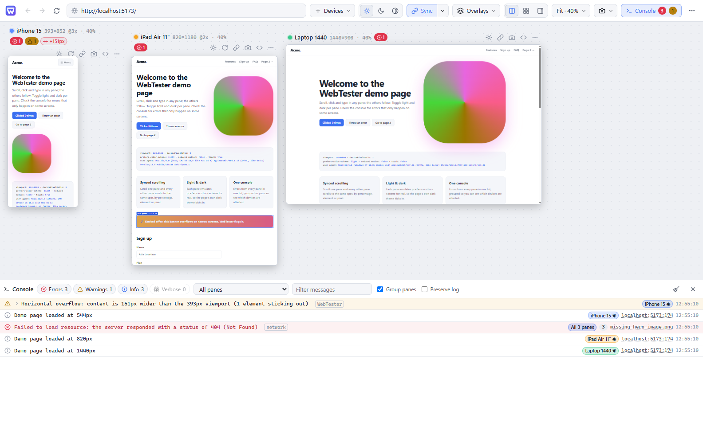
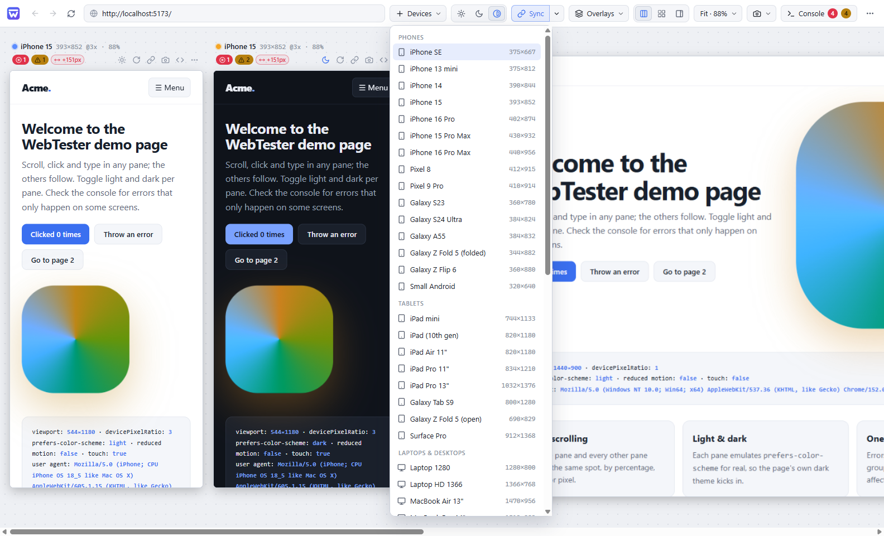
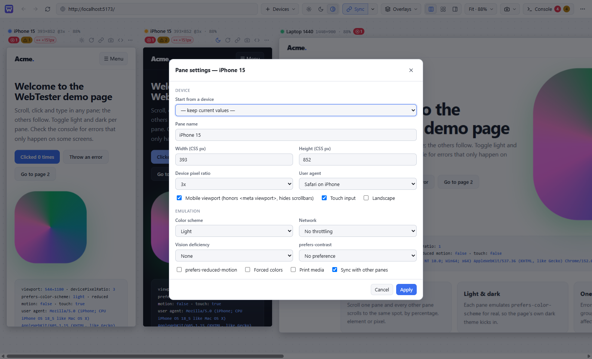
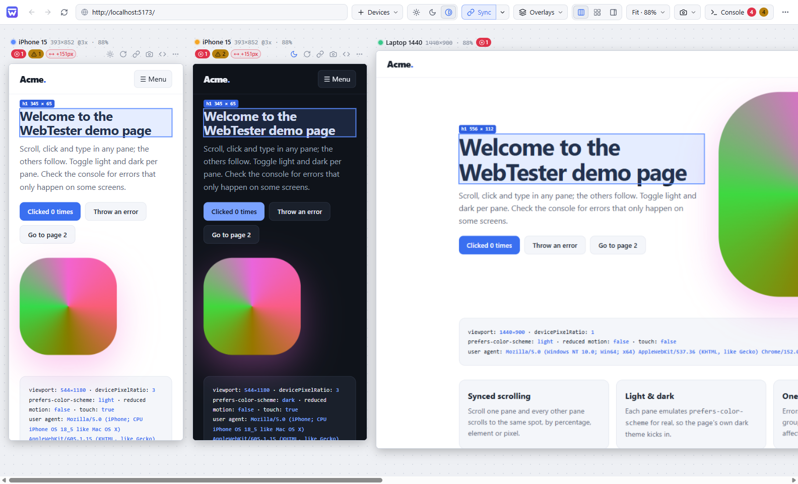
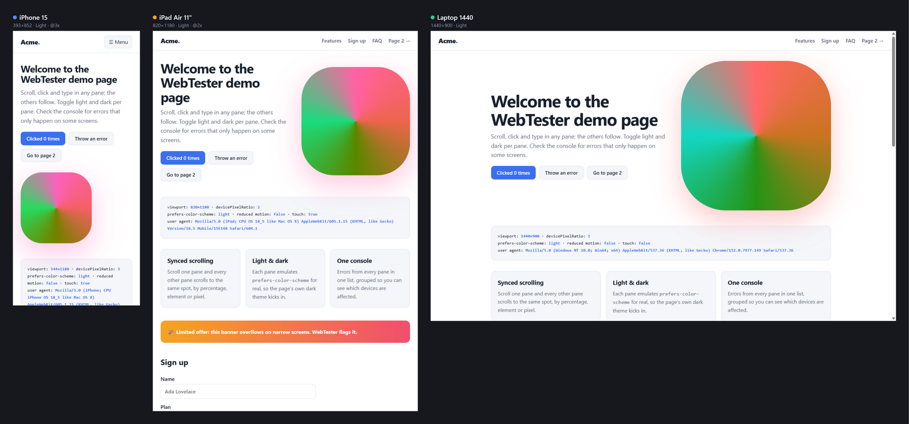

<picture>
  <source media="(prefers-color-scheme: dark)" srcset="docs/brand/lockup-dark.png">
  
</picture>

### Test your website on every screen at once.

Phones, tablets and desktops side by side, in light and dark mode, moving together as you scroll, click and type, with every error from every screen in one place.

&nbsp;

&nbsp;

 

 

## Stop resizing your browser window

You built a beautiful page. Then someone opens it on their phone, in dark mode, and the menu overlaps the logo.

Checking a site properly means looking at it on many screens in many settings, and doing that one window at a time is slow and easy to skip. **WebTester shows you all of them at once.** Open your site, and every phone, tablet and desktop you care about appears side by side, live and fully interactive.

 

## Light and dark, side by side

Most people now browse in dark mode, and it's where designs quietly break: unreadable text, invisible icons, a white flash behind every card. WebTester shows any screen in **light and dark mode next to each other**, using the real system setting your site responds to rather than a filter that only imitates it.

One click turns every screen dark, light, or into a light-and-dark pair, so you can compare them at a glance.

 

## Scroll once. Click once. Everywhere.

Everything you do in one screen happens in all of them:

- **Scroll** and every screen scrolls to the same spot, even when the layouts are completely different.
- **Click** a button, open a menu or follow a link, and every screen does the same.
- **Type** into a form, tick a box or press Enter, and every copy of the form fills in.
- **Go back and forward** together, and links that open new windows stay in the same view.

Check a whole sign-up flow on six devices in the time it takes to do it once.

 

## Every error, from every screen, in one list

Some bugs only appear on small screens, or only in dark mode. WebTester collects **every error and warning from every screen into one list** and tells you which screens it happens on: "all screens", or just "iPhone, dark".

It also checks your layout for you:

- **Content spilling off the side** of a phone screen is flagged and outlined on the page, so you can see exactly what's too wide.
- **Pages that aren't set up for phones** are called out, so they don't render zoomed out and tiny.
- **Failed images and files** show up immediately, instead of hiding until a customer finds them.

Each screen also shows a small red or yellow badge when something is wrong, so problems are visible without opening anything.

 

## More than 40 real devices, ready to go

Pick from iPhones, Pixels and Galaxy phones (including foldables), iPads and Android tablets, laptops, desktops and 4K screens, plus the standard screen-size breakpoints. Each one has the right size, sharpness, touch behaviour and browser identity, so your site behaves as it would on the real thing.

Add your own devices in seconds, rotate any phone or tablet sideways, or start from a ready-made set such as *Phone · Tablet · Desktop* or *Every common screen size*.

 

## See your site the way your visitors do

Real visitors aren't all on fast Wi-Fi with perfect eyesight. For any screen you can simulate:

- **Slow connections**: fast 4G, slow 4G, 3G or completely offline.
- **Colour blindness and blurred vision**, to check that your design still communicates.
- **Reduced motion**, high contrast and forced colours, the accessibility settings many people rely on.
- **Print**, to see what your page looks like on paper.

 

## Point at something, see it everywhere

Turn on **Inspect** and hover over anything. The same element lights up on every screen, with its exact size, so you can see at once how a heading or button changes from phone to desktop.

 

## Screenshots worth sharing

Capture one screen, the full length of a page, or **all your screens in one labelled image**, ready to drop into a bug report, a design review or a message to a client.

 

## Built for real work

- **Live reload**: point WebTester at your project folder and every screen refreshes the moment you save a file.
- **Workspaces**: save your favourite set of devices and settings, and reopen them with one click.
- **Picks up where you left off**: your screens, layout and page are restored every time you open the app.
- **Works with local sites**: `localhost`, local files and development certificates all just work.
- **Keyboard shortcuts** for everything (press <kbd>F1</kbd> in the app to see them).
- **Private by design**: no account, no tracking. Everything stays on your computer.

 

## Get WebTester

1. Go to the **[latest release](https://github.com/prabhuakshay/webtester/releases/latest)**.
2. Download **`WebTester-Setup-x.y.z.exe`** to install it, or **`WebTester-x.y.z-portable.exe`** to run it without installing.
3. Open WebTester, type your website's address, and start testing.

> **Windows may show a "Windows protected your PC" message** the first time, because WebTester is a new, independent app. Click **More info → Run anyway**. Each release lists a checksum (`SHA256SUMS.txt`) if you'd like to verify your download.

WebTester runs on Windows 10 and 11 (64-bit).

 

## Questions

**Is it free?**
Yes. WebTester is free and open source under the MIT license.

**Do I need to know how to code?**
No. If you can type a web address, you can use WebTester. Developers get extras like the error console and live reload, but designers, testers and site owners use it the same way.

**Does it work with my site?**
Any website works, whether it's live on the internet, running on your own computer, or a file on your disk.

**Does it send my data anywhere?**
No. WebTester has no account and no analytics, and doesn't upload anything. Your pages load exactly as they would in a normal browser.

**I found a bug / I have an idea.**
Please [open an issue](https://github.com/prabhuakshay/webtester/issues/new/choose). Feedback is very welcome.

 

## Contributing

WebTester is open source, and contributions are welcome. See [CONTRIBUTING.md](CONTRIBUTING.md) for how to run it from source and how releases are made.

 

Made by [Akshay Prabhu](https://github.com/prabhuakshay) · [MIT License](LICENSE)

