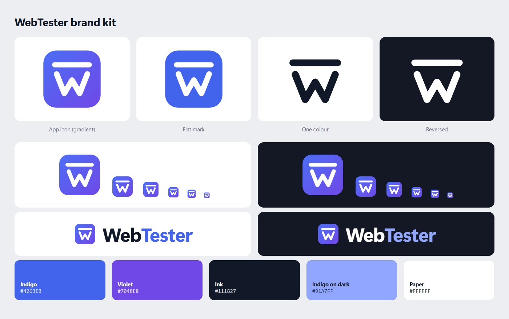

# WebTester brand

## The mark

A **W** hanging from a straight bar: the web, measured. The bar reads as a ruler or T-square (precision,
breakpoints) and, with the W, hints at **W**eb**T**ester.

| File | Use |
|---|---|
| [`../../build/icon.svg`](../../build/icon.svg) | App icon: gradient tile. Master for 64 px and up. |
| [`../../build/icon-small.svg`](../../build/icon-small.svg) | Small-size cut (heavier strokes) for 16–48 px: favicons, taskbar, `.ico`. |
| [`logo-mark.svg`](logo-mark.svg) | Flat single-colour tile, for places that can't show gradients. |
| [`logo-symbol-black.svg`](logo-symbol-black.svg) | Symbol in one colour (ink), no tile. |
| [`logo-symbol-white.svg`](logo-symbol-white.svg) | Reversed symbol for dark backgrounds (drawn slightly thinner). |
| [`lockup-light.png`](lockup-light.png) / [`lockup-dark.png`](lockup-dark.png) | Logo with wordmark for light / dark backgrounds. |
| [`social-preview.png`](social-preview.png) | 1280 × 640 card for link previews (GitHub → Settings → Social preview). |

Rendered files are generated from the SVGs with `npm run brand`.

## Colour

| Name | Hex | Use |
|---|---|---|
| Indigo | `#4263EB` | Primary brand colour, flat mark, "Tester" in the wordmark |
| Violet | `#7048E8` | Gradient end on the app icon |
| Ink | `#111827` | Text, one-colour symbol |
| Indigo on dark | `#91A7FF` | "Tester" in the wordmark on dark backgrounds |
| Paper | `#FFFFFF` | Symbol on the tile, backgrounds |

The app icon uses a diagonal gradient from `#4C6EF5` to `#7048E8`.

## Wordmark

**Web**Tester in Segoe UI Variable Display, Bold, with −2.5 % letter spacing. "Web" in Ink (or white on
dark), "Tester" in Indigo (or Indigo on dark). The rendered lockups are the reference; when the wordmark is
set in live text elsewhere, use the same font and colours.

## Usage

- **Clear space**: keep at least the height of the bar-and-W gap (about ⅛ of the tile) free around the mark.
- **Minimum size**: 16 px for the icon (use the small-size cut below 48 px); 96 px wide for the lockup.
- **Don't** stretch, rotate, recolour outside the palette, add effects, or place the gradient tile on busy photos.
